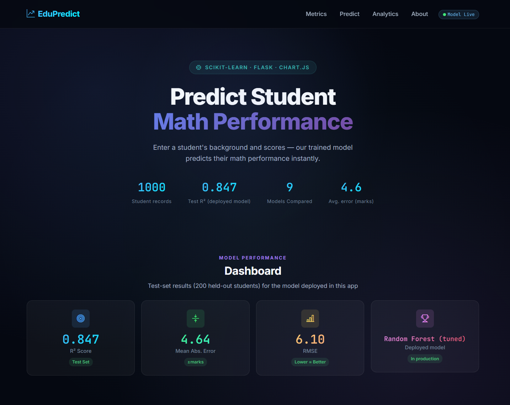
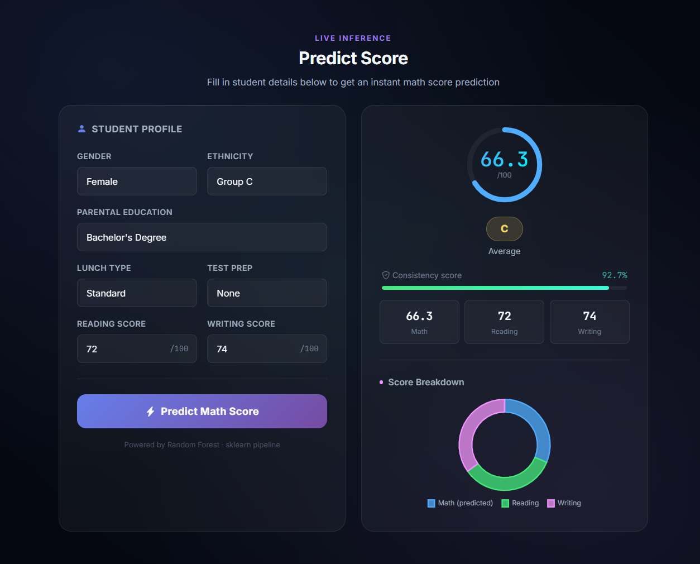
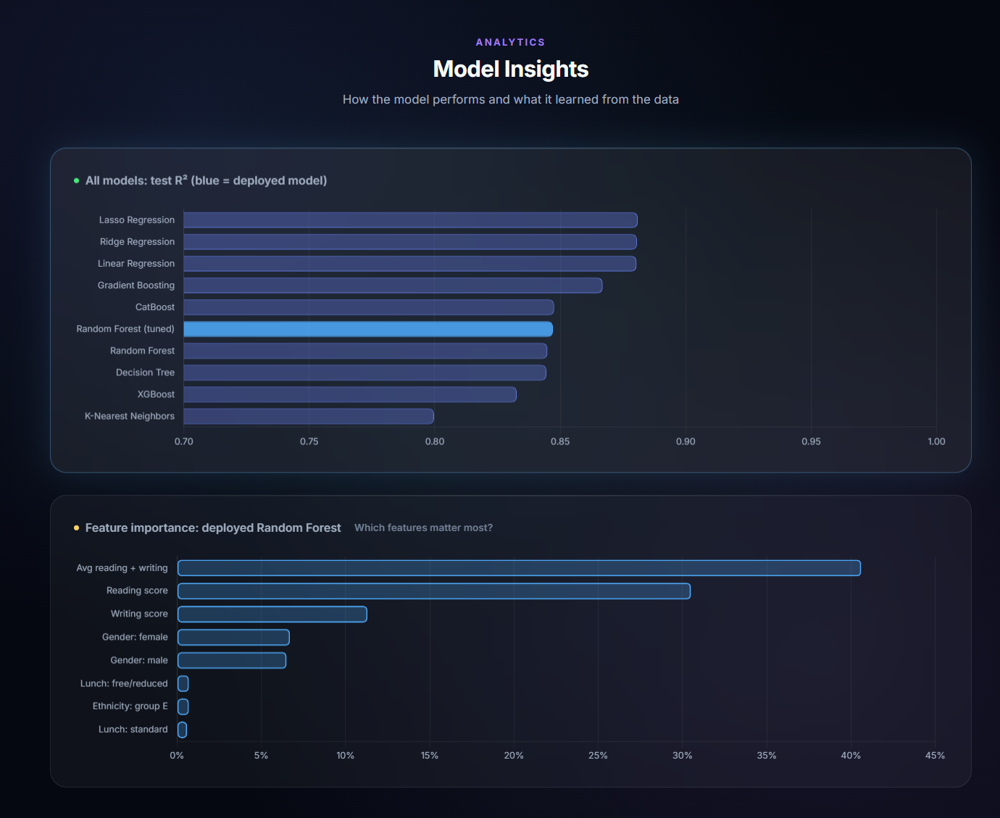

# EduPredict: Student Math Score Predictor


A small end-to-end machine learning project: predict a student's **math score** from their
background and their reading and writing scores. It covers data analysis, model comparison, a
tuned scikit-learn pipeline, a validated Flask REST API, a Chart.js dashboard, automated tests,
and deployment on Render.

**Live demo:** https://student-performance-prediction-9igt.onrender.com/
*(Free tier: the first request after a quiet period can take up to a minute while the service wakes up.)*

--> After retaking screenshots, put them in demo/ and uncomment:



-->

## Results

Dataset: [Students Performance in Exams](https://www.kaggle.com/datasets/spscientist/students-performance-in-exams)
(1,000 rows, no missing values). 80/20 train/test split (`random_state=42`), 5-fold cross-validation on the training set.

| Model | Test R² | MAE (marks) | RMSE |
|---|---|---|---|
| Lasso | 0.881 | 4.21 | 5.39 |
| Ridge | 0.881 | 4.21 | 5.39 |
| Linear Regression | 0.880 | 4.22 | 5.39 |
| Gradient Boosting | 0.867 | 4.39 | 5.69 |
| **Random Forest (tuned, deployed)** | **0.847** | **4.64** | **6.10** |
| Random Forest (default) | 0.845 | 4.76 | 6.14 |
| Decision Tree | 0.845 | 4.76 | 6.15 |
| KNN | 0.801 | 5.40 | 6.95 |

**Takeaway:** regularised linear models slightly outperformed the tuned Random Forest. Math score is
close to a linear function of reading and writing scores, and with 1,000 rows tree ensembles add
variance without finding extra structure. The most important feature is the engineered
`avg_rw_score` (about 41% importance).

## How it works

```
Colab notebook:  CSV -> EDA -> preprocessing -> compare models -> tune -> save student_model.pkl + metrics.json
Flask app:       loads the pickled sklearn Pipeline once -> /predict validates input and returns a score
Browser:         form -> fetch POST /predict -> animated result; dashboard reads /metrics
```

- **Pipeline:** `ColumnTransformer` (`StandardScaler` for numeric, `OneHotEncoder` for categorical) + model, saved as one object so
  inference gets exactly the same preprocessing as training.
- **No leakage:** a `total_score` column (contains the target) was excluded from the features.
- **Metrics are never hardcoded:** the dashboard reads `model/metrics.json`, which the notebook generates.

## API

| Route | Method | Purpose |
|---|---|---|
| `/` | GET | Dashboard |
| `/predict` | POST | JSON in, predicted math score out. Invalid input returns `400` with a clear message |
| `/metrics` | GET | Contents of `model/metrics.json` |
| `/health` | GET | Liveness check |

```json
POST /predict
{"gender":"female","race_ethnicity":"group C","parental_education":"bachelor's degree",
 "lunch":"standard","test_prep":"none","reading_score":72,"writing_score":74}

200 -> {"success":true,"score":66.34,"grade":"C","label":"Average","consistency":92.7,
        "breakdown":{"math":66.34,"reading":72.0,"writing":74.0,"average":70.78}}
```

`consistency` is a heuristic (how close the prediction is to the student's reading/writing average), **not** a statistical confidence interval.

## Run locally

```bash
python -m venv venv
venv\Scripts\activate            # Windows  (Mac/Linux: source venv/bin/activate)
pip install -r requirements.txt
python app.py                    # http://localhost:5000
```

## Tests

```bash
pip install -r requirements-dev.txt
pytest -q
```

Tests cover the routes, input validation (bad categories, out-of-range and non-numeric scores, missing fields),
grade boundaries, and a guard that the installed scikit-learn version matches the one used for training.
GitHub Actions runs them on every push.

## Retraining

1. Run the Colab notebook.
2. Run `notebooks/export_metrics_cell.py` as the last cell; it downloads `metrics.json`.
3. Replace `model/student_model.pkl` and `model/metrics.json`.
4. Make sure `requirements.txt` pins the scikit-learn version the cell printed.

## Deployment

Render (free web service), auto-deployed from `main`.
Build: `pip install -r requirements.txt`. Start: `gunicorn --bind 0.0.0.0:$PORT app:app`.
`.python-version` pins Python 3.11 (Render's newer default lacked prebuilt wheels for pandas).

## Limitations

- Small public dataset (1,000 rows); results may not transfer to other schools.
- The model needs reading and writing scores, so it is not an early-warning tool for students with no scores yet.
- Gender and ethnicity are model inputs. A real deployment would need a fairness review and probably their removal
  (the three score features already carry about 82% of the signal).
- No calibrated prediction intervals, monitoring, or automated retraining.

## Project structure

```
├── app.py                  Flask app (validation, /predict, /metrics, /health)
├── model/                  student_model.pkl, metrics.json
├── templates/index.html    dashboard
├── static/                 css/style.css, js/chart.js
├── tests/test_app.py       pytest suite
├── notebooks/              Colab notebook + export_metrics_cell.py
├── .github/workflows/ci.yml
├── requirements.txt        runtime dependencies (what Render installs)
├── requirements-dev.txt    test dependencies
├── Procfile, .python-version, pytest.ini, .gitignore
└── demo/                   screenshots
```

https://student-performance-prediction-9igt.onrender.com
